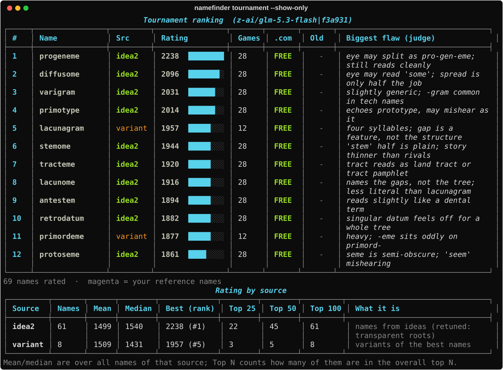
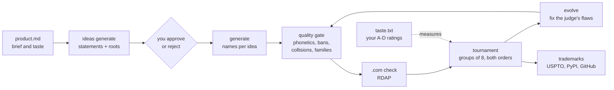
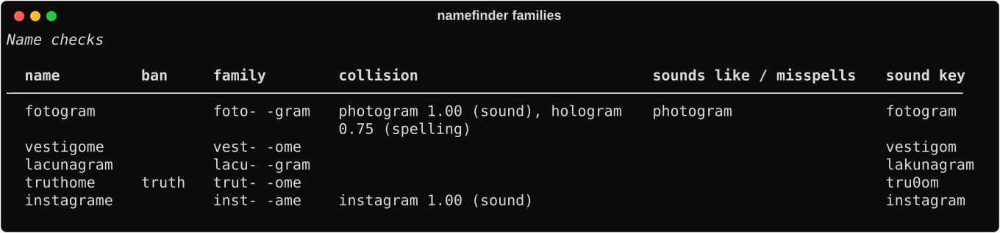

# NameFinder

[](https://github.com/SnowCode1/NameFinder/actions/workflows/tests.yml)

A command-line pipeline that finds a coined brand name for a software product. It turns a written product brief into naming ideas, invents candidate names from them, ranks the candidates against each other with an LLM judge, checks `.com` availability and trademarks, and measures how well the whole process agrees with your own taste.

Every stage is resumable (SQLite in WAL mode), every paid call is cost-capped, and the domain and trademark screens need no API keys.



*A tournament ranking from the [worked example](#worked-example-an-image-provenance-tool). Names from ideas played 28 games each, later variants 12; the judge's main objection to each name is on the right.*

## Contents

- [How it works](#how-it-works)
- [Worked example: an image provenance tool](#worked-example-an-image-provenance-tool)
- [Installation](#installation)
- [Setting up a prompt set for your product](#setting-up-a-prompt-set-for-your-product)
- [The workflow, command by command](#the-workflow-command-by-command)
- [What was measured along the way](#what-was-measured-along-the-way)
- [Project layout](#project-layout)
- [Tests](#tests)
- [Limitations](#limitations)

## How it works



- **Idea-first generation.** The model first writes *ideas*: short, true statements about the product, each with Latin or Greek roots that could carry it ("every copy has a parent": `stemma`, `propago`). You approve the ones worth naming. Names are then built per idea, each with a one-line construction note, so every candidate comes with its own answer to "why is it called that?".
- **A deterministic quality gate.** Before any model sees a name, code rejects what can be rejected for free: unpronounceable clusters and endings no English word ends on, crude fragments, ordinary dictionary words, banned roots, spelling or sound similarity to competitors and well-known brands (a rough phonetic key with weighted edits, so `fotogram` is caught as `photogram`), one-letter variants of weak names, and families (openings and endings) that already saturate the leaderboard.
- **Ranking by tournament, not by score.** Scores in isolation saturate at the top. The judge sees groups of 8 names, writes notes on each one (how the eye splits it, how it is said, its story, any fatal flaw) and only then ranks them. Every group is shown twice in opposite order to cancel position bias. Rankings feed a Plackett-Luce model with a standard error per name, refitted after every round, and names that are clearly out of contention stop playing.
- **Your taste as a test suite.** `taste.txt` holds names you rated A to D. Every pair of names in different tiers is a test case, so a judge or scorer prompt can be measured against your taste for a fraction of a cent before you commit to it, including on held-out names that no prompt is allowed to quote.
- **Evolution from stated flaws.** `evolve` takes the leaders and the flaws the judge named, and asks for redesigns that keep the root and fix the flaw. The variants re-enter the tournament against their parents.
- **Free screening.** `.com`, `.io` and `.dev` availability comes straight from the registries over RDAP; trademarks are screened against USPTO (via Markbase), PyPI and GitHub.

There is also an older bulk pipeline (filter 90,000 English words, score them as roots, coin tens of thousands of variants with rule engines and an LLM engine, with a Thompson-sampling bandit choosing which base words to coin from). It still works and can feed the tournament; see [USAGE.md](USAGE.md).

## Worked example: an image provenance tool

The repository ships a complete prompt set for an invented product in [`examples/image-provenance/`](examples/image-provenance/): a newsroom tool that traces where a photo first appeared and every copy and edit since, without ruling on whether the image is real. Everything below is real output from one run on that prompt set, in a separate database. The run cost about four cents in total on the default model (`z-ai/glm-5.3-flash` via OpenRouter).

**1. The brief** ([`product.md`](examples/image-provenance/product.md)), excerpt:

> An image provenance tool for newsrooms: it traces where a photo or video frame first appeared, every copy and edit since, and how it spread. [...] The tool shows the record and how well each step is supported; it does not rule on whether an image is real or fake, and the person draws the conclusion. [...] Names must not overclaim: nothing that promises truth, proof or authenticity.

**2. Ideas.** `ideas generate --per-angle 4` asked for ideas across nine weighted angles (origin, spread, evidence, gaps and so on), then merged 11 near-duplicates: 24 ideas from 10 calls, $0.0009. A few of the 14 approved:

| # | Angle | Idea | Some of its roots |
|---|---|---|---|
| 10 | origin | Tracing back along the chain of copies until the trail reaches its start or goes cold. | retro, trace, vestige, root |
| 15 | lineage | A family tree of copies: branches for edits and crops, each node linked to its parent with stated evidence. | tree, ramus, stem, gene |
| 18 | gaps | The record names its own absences: cold trails, missing sources, unsupported links. | gap, vestige, lacuna, trace |
| 19 | gaps | Unsourced copies: images whose earliest known upload is not the first, flagged as orphans awaiting a parent. | orphan, stem, root, genos |

**3. Names.** `generate --per-idea 30` produced 220 names that passed the gate, each with a construction note, for $0.006; 68 had a free `.com`:

```text
progeneme   #14  progen + -eme: one descent step, a child copy with its parent
diffusome   #5   diffuse + -ome: the whole system of copies spread outward from one source
lacunome    #18  lacuna + -ome: the whole set of holes in a picture's documented history
antestem    #10  ante + stem: the stem line extended back past known copies
orphaneme   #19  orphan + -eme: an image unit with no known parent yet
```

**4. Tournament.** `tournament --source ideas --rounds 8` ranked the 61 names with a free `.com` in 128 judge calls for $0.014. The judge ordered 64% of name pairs the same way in both presentation orders (50% would be a coin flip), and flagged 5% of judgements as fatal.

**5. Evolve and re-rank.** `evolve --top 12` asked for redesigns of the leaders that fix their stated flaws. 44 proposals came back, the gate kept 24, and 10 had a free `.com`. For example, `lacunome` ("names the gaps, not the tree") became `lacunagram` ("-gram makes it a documented record of gaps"). After six more rounds, `lacunagram` entered the top five, as the ranking at the top of this page shows.

**6. Name checks.** `families` explains why the gate rejects or flags a name:



`fotogram` shares its sound key with the field term `photogram`, `instagrame` echoes a brand, and `truthome` breaks a ban, since a tool that does not rule on authenticity should not be named for truth.

**7. Trademark screen.** `check-trademarks --tournament 8 --no-ipgod` checks the leaders against live USPTO marks in the software, SaaS, data and education classes, plus PyPI and GitHub. Owner names are omitted here:

```text
Name        USPTO          Closest live or pending mark      PyPI   GitHub
progeneme   watch (high)   PROGENE, similarity 0.85          clear  clear
diffusome   watch (low)    DIFFUZYME, similarity 0.47        clear  clear
varigram    clear (low)    VARIORAM, similarity 0.53         clear  clear
lacunagram  clear (low)    LUNAGRAM, similarity 0.48         clear  clear
```

**8. Taste.** [`taste.txt`](examples/image-provenance/taste.txt) rates 32 of the names A to D. `taste --eval 12 --seed 1` played 12 groups of those names through the judge (24 calls, $0.0024, nothing saved):

```text
[taste] agreement with your tiers: 84% per call, 87% pooled over 24 calls (317 pairs, 30 names)
[taste] held-out names only: 85% (13 pairs); the honest number once prompts carry examples
[taste] judge consistency between the two orders: 78%
[taste] worst misses: rooteme (D) > lineadex (A), primotype (C) > lineadex (A), ...
```

These example ratings were written after the tournament had run, so treat 87% as a demonstration of the mechanism rather than a benchmark. The [measurements below](#what-was-measured-along-the-way) come from a real project, where the ratings came first.

To reproduce the run with your own OpenRouter key:

```bash
export NAMEFINDER_PROMPTS=examples/image-provenance NAMEFINDER_DB=data/demo.db
namefinder ideas generate --per-angle 4
namefinder ideas list                       # then: namefinder ideas mark --approve 2 3 5 --reject 1 4
namefinder generate --per-idea 30
namefinder tournament --source ideas --rounds 8
namefinder evolve --top 12 && namefinder tournament --source ideas --rounds 6
namefinder families --word fotogram --word lacunagram
namefinder check-trademarks --tournament 8 --no-ipgod
namefinder taste --eval 12 --seed 1
```

(On PowerShell, set the variables with `$env:NAMEFINDER_PROMPTS = "examples/image-provenance"` and `$env:NAMEFINDER_DB = "data/demo.db"`.) Model output varies between runs, so your names will differ.

## Installation

Requires Python 3.10 or later.

```bash
git clone https://github.com/SnowCode1/NameFinder.git
cd NameFinder
python -m venv .venv
source .venv/bin/activate          # Windows: .venv\Scripts\Activate.ps1
pip install -e .
cp .env.example .env               # then add OPENROUTER_API_KEY
```

An [OpenRouter](https://openrouter.ai) key is the only key the recommended workflow needs. The default model costs a fraction of a cent per call, every paid command stops at `--max-cost` (default $1.00), and OpenRouter requests are routed to the cheapest provider for the model. Any OpenAI-compatible endpoint works, including a local LM Studio or Ollama server (`--backend local`). Domain checks, trademark screening and every name check are free.

## Setting up a prompt set for your product

Everything specific to your product lives in one folder, your *prompt set*: `prompts/` by default, which is gitignored, or any folder named by `NAMEFINDER_PROMPTS`. Every file is optional. A missing file falls back to a built-in, product-neutral default, so you can start with just the brief and add the rest as you learn what you want.

The quickest start is to copy the worked example and rewrite it:

```bash
cp -r examples/image-provenance prompts
```

### 1. Write the brief: `product.md`

The brief is the most important file. Every built-in prompt (ideas, names, variants, scoring, the judge, the shortlist) includes it as `{product}`. A good brief has five parts, and the example shows each:

1. **What it is and how it works**, concretely: the data, the structure, the operations. Ideas are built from these facts, so vague claims produce vague ideas.
2. **What it is for**: what its user can see or do that they could not before. This is where the most distinctive ideas come from.
3. **Audience, and what it is not.** Naming the wrong readings ("not a deepfake detector, not a photo-editing app") gives the judge its *wrong meaning* flag.
4. **Voice.** "Technical and plain, no superlatives" steers every stage away from hype. If the product must not overclaim, say so here.
5. **What makes a good name**: the shape of name you want, with reference words ("beside codex, lexicon, genome"), and what to avoid. Write this part after you have rated your first batch (step 5), so it describes your taste rather than a guess at it.

### 2. Shape the ideas: `angles.txt`

Angles are the directions ideas are generated from, one per line: `name | weight | description`. The weight scales how many ideas an angle gets, so central themes get more and minor ones fewer:

```text
origin      | 1.2 | where an image began: the first upload, the original capture, what came before every copy
gaps        | 1.2 | PURPOSE: what the record does not yet show: where the trail goes cold, conflicting dates
alteration  | 0.4 | MINOR: typed edits (crop, filter, splice, recaption) and what changed between a copy and its parent
```

Without this file a generic set is used (mechanism, material, purpose, gaps, inquiry, history, exploration).

### 3. Fence off the field: `collision_terms.txt`, `bans.txt`, `category_anchors.txt`

- **`collision_terms.txt`**: competitors, the field's own vocabulary and well-known brands. A new name that looks or sounds like any of them is rejected.
- **`bans.txt`**: roots that are wrong in meaning for your product, as `root proof`, `prefix deep` or `ending ify`. No engine can produce them, and every generation prompt lists them.
- **`category_anchors.txt`**: phrases that name what the product literally is. Idea seeds (`namefinder embed`) are penalised for sitting close to them, so a base word that *hints* at an idea beats one that only names the category.

### 4. Generate and rank a first batch

Run steps 1 to 3 of [the workflow](#the-workflow-command-by-command) with the built-in judge. The first ranking matters less than what it shows you about your own taste.

### 5. Rate names: `taste.txt`

Rate 40 or more of the generated names, across all four tiers, with a short reason for each:

```text
lineadex     A   # lineage + -dex: an index of lines of descent; reads like a reference work
lacunagram   B   # lacuna + -gram: a chart of the gaps; true story, but names one feature
varigram     C   # generic; variance and statistics come first
hiatome      D   # sounds like a surgical instrument
```

Then measure how far the judge agrees with you: `namefinder taste` compares every stored ranking with your tiers (no API calls), and `taste --eval 20 --seed 1` plays groups of your names through the current judge prompt. Mark a few names `[held out]` and never quote them in a prompt, so the held-out score stays an honest measure.

### 6. Tune the judge if it disagrees with you

When agreement is low, the reasons in your ratings say why. Turn them into rules in the brief's last paragraph, or write a full `tournament_prompt.md` (start from `DEFAULT_JUDGE_PROMPT` in [`namefinder/tournament.py`](namefinder/tournament.py)). Measure the draft before it starts a new rating set:

```bash
namefinder taste --eval 20 --seed 1 --prompt prompts/tournament_prompt.draft.md
```

Use the same seed for every draft so each one is judged on the same groups.

### 7. Optional overrides

Any built-in prompt can be replaced by a file in the prompt set:

| File | Replaces the built-in prompt for | Placeholders |
|---|---|---|
| `ideas_prompt.md` | `ideas generate` | `{product}` |
| `names_prompt.md` | `generate` | `{product}`, `{max_len}` |
| `evolve_prompt.md` | `evolve` | `{product}`, `{max_len}` |
| `tournament_prompt.md` | the tournament judge and `taste --eval` | `{product}` |
| `system_prompt.md`, `user_prompt.md` | brand scoring and `taste --scorer` | `{product}` in the system prompt |
| `root_prompt.md` | root scoring of base words | `{product}` |
| `coin_prompt.md` | the LLM coining engine | |
| `refine_prompt.md`, `refine_user_prompt.md` | the spoken-name review | |
| `final_system_prompt.md`, `final_user_prompt.md` | `rank-final` shortlist report | `{product}` in the system prompt |
| `tournament_refs.txt` | benchmark names that always play in the tournament | |
| `concept_roots.txt` | partner words for portmanteaus and compounds | |

Each brand score stores a fingerprint of the prompts that produced it, and each tournament rating set is keyed by judge model and prompt hash. Editing a prompt never mixes old and new results: `namefinder rescore` re-scores stale names, and a changed judge starts a fresh rating set while the old one stays stored.

## The workflow, command by command

```bash
# 1. Ideas: true statements about the product, each with candidate roots
namefinder ideas generate --per-angle 10      # propose ideas per angle, then merge duplicates
namefinder ideas review                       # approve / reject / edit, one at a time

# 2. Names from the approved ideas (.com is checked automatically)
namefinder generate --per-idea 30

# 3. Rank by tournament
namefinder tournament --source ideas --rounds 8
namefinder evolve                             # redesign the leaders from the judge's flaws
namefinder tournament --source ideas --rounds 6

# 4. Inspect and screen the leaders
namefinder top --by tournament --free-domains -n 30
namefinder families --word yourpick           # bans, families, collisions, sound-alikes
namefinder check-trademarks --tournament 25 --no-ipgod

# 5. Measure the judge against your own ratings
namefinder taste --eval 20 --seed 1
```

Repeat steps 3 and 4 until the top of the table stops changing. Near the top the judge agrees with itself on only about 60% of pairs, so treat neighbouring ranks as ties and choose among the top few dozen yourself. Every command, option and setting is documented in [USAGE.md](USAGE.md).

## What was measured along the way

NameFinder was built while naming a real product, and most design decisions came from measuring the pipeline against hand ratings. These numbers come from that project:

- **The first objective was wrong, and the ratings showed it.** The early prompts favoured *oblique* names that hint at what the user does. Against 115 hand-rated names, that judge agreed with the ratings on 48% of pairs, worse than chance. Rewriting the judge around the rated taste (a sober term built on a half-known classical root) took agreement from 56% to 70% on the same draw, from 45% to 70% on held-out names, and the judge's consistency between orders from 68% to 84%. The brand scorer, rewritten the same way, went from 44% to 71%.
- **Notes before verdicts.** When the judge wrote each name's flaw *after* ranking, the flaws made no difference: rankings from calls that noted a flaw matched the final ratings 72.1% of the time, against 71.9% without. A name drew "ln reads as line break" and still placed third. The judge now writes its notes first and labels fatal flaws, and code moves a fatally flawed name to the bottom of its group.
- **Plackett-Luce over Elo.** On the same logged matches, a Plackett-Luce fit was far more stable than a running Elo: split-half rank correlation of 0.76 against 0.30 on the top 100.
- **Group size and routing.** Groups of 8 were 2.4 times cheaper per pairwise comparison than groups of 5 at the same consistency, and routing to the cheapest provider for the model was about 3 times cheaper per judge call, with no measurable loss in consistency.
- **Engines judged on data.** `namefinder engines` reports each coining engine's *tail rate* (the share of its names that reach the top 5%). Engines that stayed near the floor (vowel shifts at 1 to 4%, near-word mutations at 5%, against about 30% for the other engines in the same window) were retired as blind engines and kept only as small edits of proven winners. Before a filter for one-letter variants of weak names, about half of a day's coined names were such respellings, each costing a scoring call.

## Project layout

```text
namefinder/
  cli.py            argparse entry point, one subcommand per stage
  config.py         paths, weights, endpoints; loads the prompt set
  db.py             SQLite schema and queries
  ideas.py          idea generation, merging and review
  ideanames.py      names from approved ideas; the shared registration gate
  evolve.py         variants of the leaders from the judge's flaws
  tournament.py     group judging, pool selection, pruning
  ratings.py        Plackett-Luce fit with standard errors
  taste.py          agreement with your ratings; prompt evaluation
  families.py       bans, families, collisions, sound keys and sound-alikes
  phonetics.py      syllables, pronounceability, unreadable endings
  wordlike.py       letter-trigram wordlikeness floor
  domains.py        RDAP availability (.com, .io, .dev)
  trademarks.py     USPTO (Markbase), PyPI, GitHub, optional IP Australia
  embed.py          meaning embeddings and idea seeds
  score.py          root and brand scoring, spoken-name review
  refine.py         re-sampled spoken review for the top names
  words.py, lexicon.py, coin.py, llmcoin.py, bases.py, engines.py
                    the bulk pipeline: wordlist, extra layers, coining engines, base bandit, engine report
  budget.py, llm.py, net.py, console.py
                    spend limits, shared LLM call, HTTP pacing and retries, terminal UI
examples/image-provenance/   the worked example's prompt set
tests/                       pytest suite (no network or API key)
USAGE.md                     full command reference
```

## Tests

```bash
pip install -e ".[test]"
pytest
```

The suite covers the deterministic core and needs no API key or network: the Plackett-Luce fit (including recovery of known strengths from simulated rankings), taste agreement and held-out handling, sound keys, collisions, bans and family saturation, readability and the coining gate, prompt-set loading and fallbacks (and that every built-in prompt is product-neutral), the worked example's files, the database layer and the CLI parser. It runs against an empty prompt set and a throwaway database, on Linux and Windows, in CI.

## Limitations

- The trademark screen is a screen, not legal clearance. It searches a few classes of USPTO marks by similarity and needs a lawyer's review before you commit to a name.
- An LLM judge is noisy near the top of the table. The tournament's ratings come with standard errors for that reason, and the final choice is meant to be yours.
- The built-in prompts encode one taste: coined words that sound like technical terms. Other styles (short invented brands, real words, compounds) need a different brief, different ratings and probably a custom `tournament_prompt.md`.

## License

[MIT](LICENSE)
